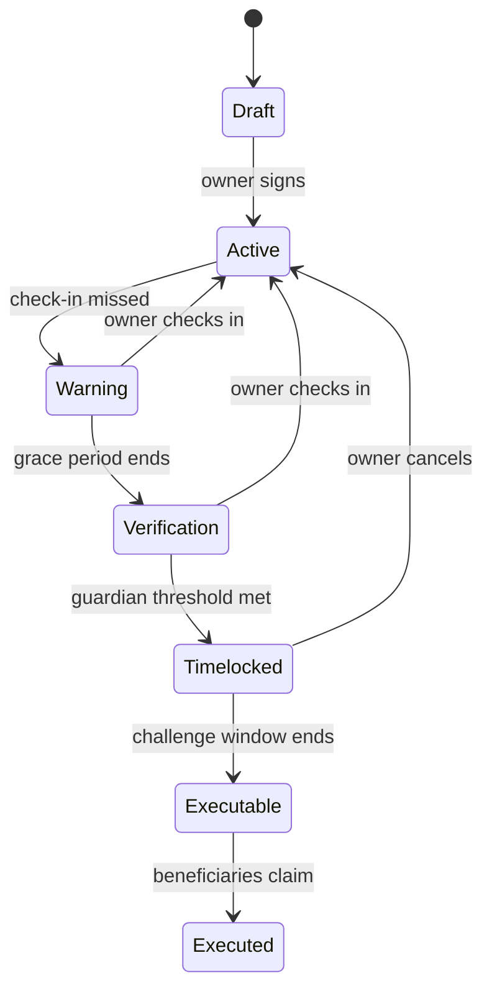

# Architecture

## Components

1. **Vault layer:** the owner's Safe smart account with a custom inheritance module
2. **Will registry contract:** will state, heartbeat timestamp, guardian set, time-lock settings, Merkle root
3. **Frontend:** owner, guardian and beneficiary dashboards
4. **Off-chain storage:** AES-encrypted will details on IPFS
5. **Key-share management:** decryption key split among guardians using Shamir secret sharing
6. **Notification service (optional):** email and SMS check-in reminders

## Will State Machine

## Data Flow

1. Owner builds the allocation list in the browser and computes a Merkle root
2. The root and settings are written on-chain; details are encrypted and stored off-chain
3. The owner checks in periodically with a signed transaction or message
4. If check-ins stop, alerts go out, then guardians may attest
5. After the time-lock, beneficiaries submit Merkle proofs to claim

## Design Principles

- Non-custodial: the platform never holds keys or funds
- On-chain enforcement: execution does not depend on the platform being online
- Privacy by default: only commitments are public
- Safety over speed: multiple layers protect against false triggers
